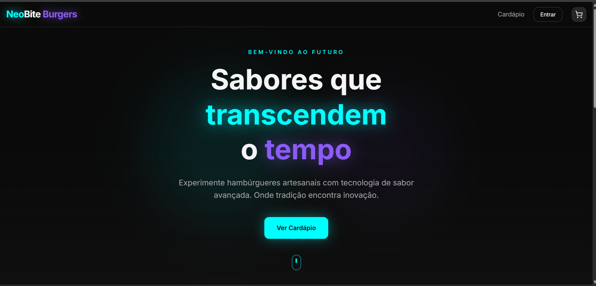
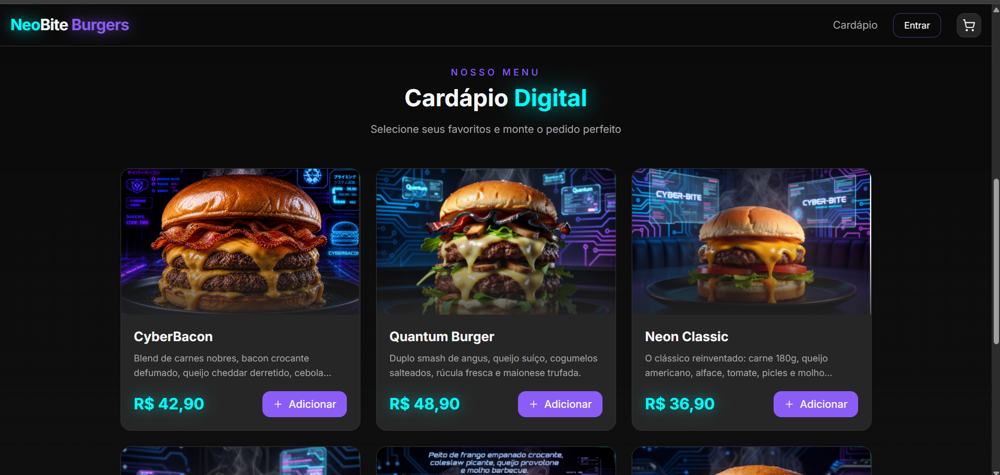
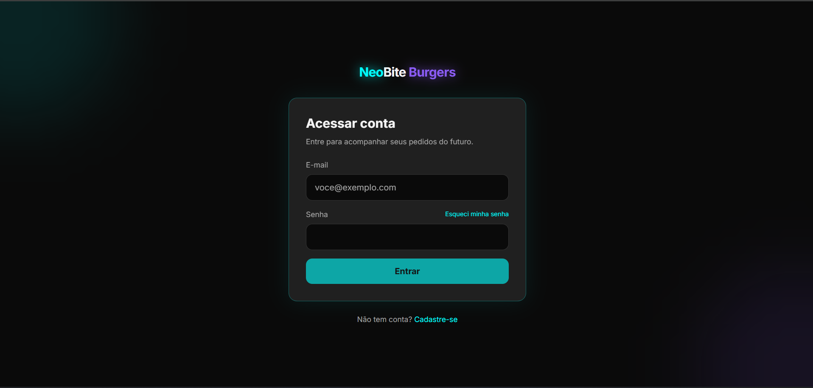
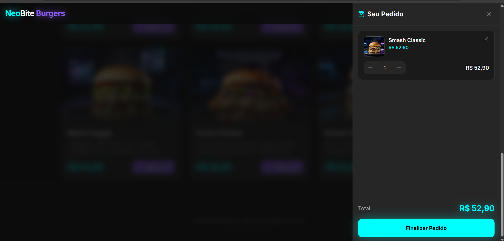

<div align="center">

# 🍔 NeoBite Burgers

**Plataforma full stack de pedidos online com identidade visual cyberpunk.**


[🚀 Ver aplicação online](https://v0-app-de-hamburgueria-futurista.vercel.app/)

</div>

---

## 📖 Sobre o projeto

A **NeoBite Burgers** começou como um protótipo acadêmico e evoluiu para uma aplicação full stack completa, com autenticação, persistência de dados, painel administrativo e gerenciamento de pedidos.

O projeto simula uma hamburgueria moderna com cardápio dinâmico, carrinho, checkout e acompanhamento de pedidos, tudo com uma interface futurista em tons de ciano e roxo neon.

> ⚠️ **Aviso:** os pagamentos são simulados para fins educacionais. Nenhuma cobrança real é realizada.

## 📑 Índice

- [Demonstração](#-demonstração)
- [Screenshots](#-screenshots)
- [Funcionalidades](#-funcionalidades)
- [Arquitetura](#️-arquitetura)
- [Tecnologias](#️-tecnologias)
- [Fluxo do sistema](#-fluxo-do-sistema)
- [Instalação local](#-instalação-local)
- [Banco de dados](#️-banco-de-dados)
- [Criando administradores](#-criando-administradores)
- [Estrutura do projeto](#-estrutura-do-projeto)
- [Segurança](#-boas-práticas-de-segurança)
- [Roadmap](#️-roadmap)
- [Autor](#-autor)

## 🚀 Demonstração

🔗 **Aplicação online:** https://v0-app-de-hamburgueria-futurista.vercel.app/

## 📸 Screenshots

<table>
  <tr>
    <td align="center">
      <br>
      <b>Página Inicial</b>
    </td>
    <td align="center">
      <br>
      <b>Cardápio Digital</b>
    </td>
  </tr>
  <tr>
    <td align="center">
      <br>
      <b>Login</b>
    </td>
    <td align="center">
      <br>
      <b>Carrinho / Seu Pedido</b>
    </td>
  </tr>
</table>

## ✨ Funcionalidades

### 👤 Cliente

- ✅ Cardápio dinâmico integrado ao Supabase
- ✅ Carrinho de compras
- ✅ Checkout completo
- ✅ Cadastro de usuários
- ✅ Login e logout
- ✅ Recuperação de senha
- ✅ Histórico de pedidos
- ✅ Avaliação de pedidos
- ✅ Controle de sessão
- ✅ Exibição do status dos pedidos

### 🛠️ Administração

- ✅ Dashboard administrativo com indicadores de pedidos
- ✅ Faturamento total
- ✅ Gestão de produtos (cadastro, edição, exclusão e ativação/desativação)
- ✅ Gestão de pedidos com alteração de status
- ✅ Controle de acesso administrativo

### 🔐 Segurança

- ✅ Supabase Auth
- ✅ Row Level Security (RLS)
- ✅ Proteção de rotas privadas
- ✅ Controle de permissões
- ✅ Associação segura entre usuários e pedidos
- ✅ Recálculo dos pedidos no servidor
- ✅ Proteção contra pedidos duplicados

## 🏗️ Arquitetura

```text
┌─────────────────────────────────────────────┐
│  Frontend: Next.js + React + TypeScript     │
│            Tailwind CSS + shadcn/ui         │
└──────────────────────┬──────────────────────┘
                       │
┌──────────────────────▼──────────────────────┐
│  Backend: Supabase                          │
│    ├─ Auth (Supabase Auth)                  │
│    └─ Banco de dados (PostgreSQL + RLS)     │
└──────────────────────┬──────────────────────┘
                       │
┌──────────────────────▼──────────────────────┐
│  Hospedagem: Vercel                         │
└─────────────────────────────────────────────┘
```

## 🛠️ Tecnologias

| Categoria | Tecnologias |
|---|---|
| **Frontend** | Next.js 16, React 19, TypeScript, Tailwind CSS 4, shadcn/ui, Radix UI, Lucide React |
| **Backend** | Supabase |
| **Banco de dados** | PostgreSQL |
| **Autenticação** | Supabase Auth |
| **Segurança** | Row Level Security (RLS) |
| **Monitoramento** | Vercel Analytics |
| **Hospedagem** | Vercel |

## 🔄 Fluxo do sistema

### Cliente

```text
Cadastro → Login → Cardápio → Carrinho → Checkout → Pedido registrado → Avaliação → Histórico
```

### Administrador

```text
Login → Painel administrativo → Dashboard → Gestão de produtos → Gestão de pedidos → Atualização de status
```

## 📦 Instalação local

### Pré-requisitos

- Node.js 20+
- npm ou pnpm
- Conta no [Supabase](https://supabase.com)

### Passo a passo

**1. Clone o projeto**

```bash
git clone https://github.com/DenilsonFerreiraDev/NeoBiteBurguer.git
cd NeoBiteBurguer
```

**2. Instale as dependências**

```bash
npm install
```

**3. Configure as variáveis de ambiente**

Crie o arquivo `.env.local` com base no `.env.example`:

```env
NEXT_PUBLIC_SUPABASE_URL=
NEXT_PUBLIC_SUPABASE_ANON_KEY=
```

**4. Execute a aplicação**

```bash
npm run dev
```

Acesse: http://localhost:3000

### ✅ Build de produção

```bash
npm run lint
npm run build
```

## 🗄️ Banco de dados

| Tabela | Responsabilidade |
|---|---|
| `products` | Catálogo de produtos |
| `orders` | Registro dos pedidos |
| `reviews` | Avaliações dos pedidos |
| `admin_users` | Controle de administradores |

Mais detalhes em [`docs/DATABASE.md`](./docs/DATABASE.md).

## 👨‍💼 Criando administradores

Depois de criar e confirmar uma conta, execute no **SQL Editor** do Supabase:

```sql
insert into public.admin_users (user_id)
select id
from auth.users
where email = 'admin@exemplo.com'
on conflict (user_id) do nothing;
```

Em seguida, faça login novamente e acesse `/conta` → **Admin**.

Mais detalhes em [`docs/admin.md`](./docs/admin.md).

## 📁 Estrutura do projeto

```text
app/
├── admin/
├── auth/
│   ├── login/
│   ├── sign-up/
│   ├── forgot-password/
│   └── update-password/
├── conta/
├── layout.tsx
└── page.tsx

components/
├── neobite/
└── ui/

docs/
├── DATABASE.md
└── admin.md
```

## 🔐 Boas práticas de segurança

- Nunca enviar arquivos `.env` para o repositório
- Nunca expor a **Service Role Key**
- Nunca expor senhas do banco
- Manter o **RLS** sempre habilitado
- Usar apenas a chave pública (anon) no frontend
- Ativar o **Secret Scanning** no GitHub

## 🗺️ Roadmap

- [ ] Integração com pagamentos reais
- [ ] Cupons persistidos
- [ ] Programa de fidelidade
- [ ] Dashboard avançado
- [ ] Notificações em tempo real
- [ ] Rastreio de pedidos
- [ ] Recomendações com IA
- [ ] Aplicativo mobile

## 🎯 Objetivos do projeto

Este projeto foi desenvolvido com foco em:

- Desenvolvimento Full Stack
- Next.js e TypeScript
- Banco de dados PostgreSQL
- Autenticação e controle de acesso
- Segurança
- Arquitetura web
- Experiência do usuário (UX)

## 👨‍💻 Autor

**Antonio Denilson Ferreira Araujo**

[](https://github.com/DenilsonFerreiraDev)
[](https://www.linkedin.com/in/denilson-ferreira-dev/)

## 📄 Licença

Projeto desenvolvido para fins educacionais e demonstração de competências em desenvolvimento Full Stack.

---

<div align="center">

⭐ Se este projeto foi interessante para você, considere deixar uma estrela no repositório.

</div>
